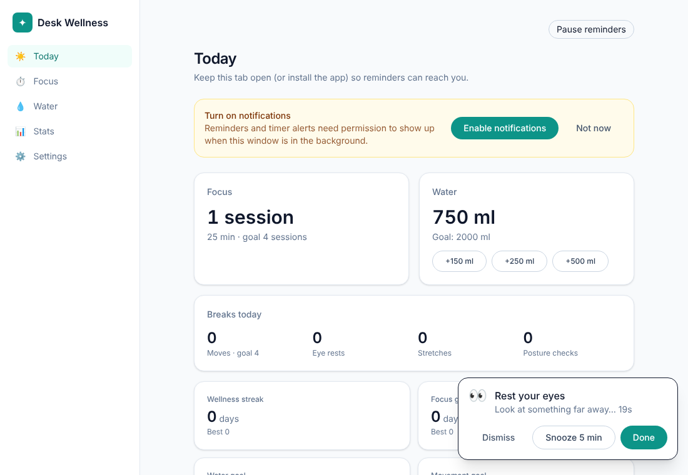
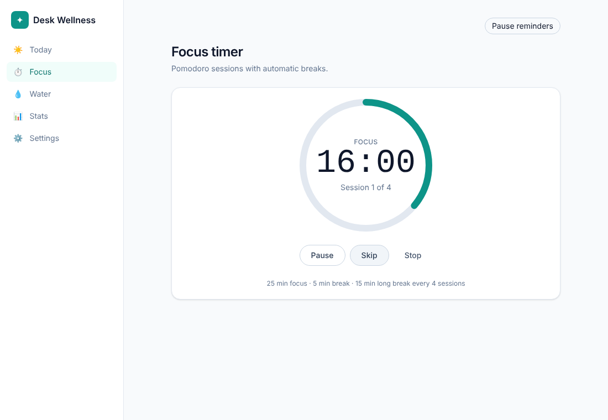
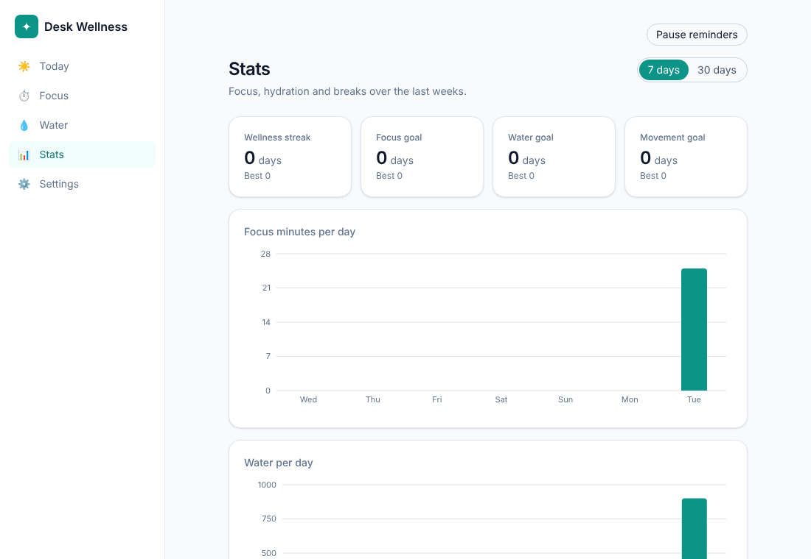
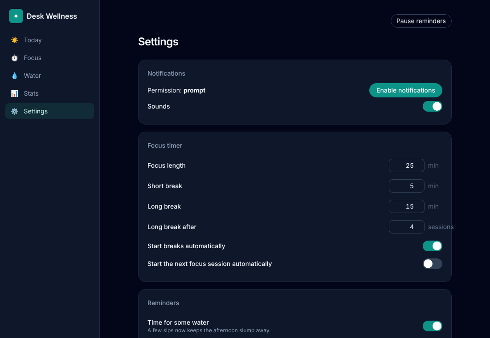

# Desk Wellness

Focus timer, hydration tracker and break reminders for people who sit at a desk all day.
One codebase ships as a **Windows / macOS tray app** (Tauri 2) and as an **installable web app**.

> Status: **v1 feature-complete** (milestones M0–M6). Verified in CI with unit and browser tests; the desktop
> build is compile-checked in CI and needs a manual pass on Windows/macOS per `docs/RELEASE_CHECKLIST.md`
> before the first tagged release.



| Focus timer                                  | Stats                                      | Settings (dark)                                 |
| -------------------------------------------- | ------------------------------------------ | ----------------------------------------------- |
|  |  |  |

## Features (v1 scope)

| Feature         | What it does                                                                                                          |
| --------------- | --------------------------------------------------------------------------------------------------------------------- |
| Focus timer     | Pomodoro 25/5 with a long break every 4 sessions, notifications at each phase change, countdown in the tray           |
| Water           | Daily goal (2000 ml default), quick-add buttons, a reminder every 45 min that stops once the goal is met              |
| Move            | "Stand up and walk" every 60 min                                                                                      |
| Eye rest        | 20-20-20 rule: every 20 min, look 20 ft away for 20 s                                                                 |
| Stretch         | Short guided stretches every 90 min                                                                                   |
| Posture         | Gentle posture nudge every 30 min                                                                                     |
| Stats & streaks | Today summary, 7/30-day charts, streaks that skip non-working days                                                    |
| Smart behaviour | Reminders defer to Pomodoro breaks, coalesce into one notification, pause outside work hours, never burst after sleep |

Roadmap: end-of-day summary, ambient sound player, task label per session, optional cloud sync.

## Platforms

- **Desktop (recommended)** – lives in the tray, keeps reminding you while the window is hidden, launches at login.
- **Web / PWA** – same UI in the browser. Notifications only arrive while the tab or installed app is open; the browser has no background service for a closed tab. Use the "Install" banner (Chrome/Edge) to run it as its own window with persistent storage.

## Development

Requirements: Node 22, pnpm 10, and for the desktop app a Rust toolchain plus the
[Tauri prerequisites](https://tauri.app/start/prerequisites/) for your OS.

```bash
pnpm install
pnpm dev            # web app on http://localhost:1420
pnpm tauri dev      # desktop app (opens its own window)

pnpm test           # unit tests (Vitest)
pnpm e2e            # browser smoke tests (Playwright)
pnpm lint && pnpm typecheck && pnpm format:check
pnpm build          # web production build in dist/
pnpm tauri build    # desktop installers in src-tauri/target/release/bundle/

node scripts/generate-sounds.mjs   # regenerate the bundled notification sounds (WAV)
```

If Playwright's bundled browser is not installed locally, point the tests at an existing Chromium with
`PLAYWRIGHT_CHROMIUM_PATH=/path/to/chrome pnpm e2e`.

macOS note: notifications only work from a bundled app, so test them with
`pnpm tauri build --debug`, not `pnpm tauri dev`.

## Project layout

```
src/
  core/        pure TypeScript domain logic (models, day keys, scheduler, stats) – no React, no Tauri, no Dexie
  platform/    Platform adapter: tauri.ts, web.ts, fake.ts (tests); picked at runtime
  storage/     Dexie (IndexedDB) database, sync-ready repositories, settings
  app/         providers, layout, hooks
  features/    UI per feature (today, timer, water, stats, settings)
  components/  shared UI
  sw/          service worker (PWA, notification actions)
src-tauri/     Rust shell: plugins, tray icon, 1 s heartbeat, close-to-tray
.github/       CI (typecheck/lint/test/build/e2e + cargo clippy), Pages deploy, desktop release
docs/          release checklist
```

### Design notes

- **Absolute timestamps everywhere.** Timers store `endsAt` / `nextFireAt` in epoch ms and derive the remaining
  time from `now`, so they stay correct after sleep, tab throttling or DST changes.
- **Heartbeat, not `setInterval`.** On desktop Rust emits a 1 s event (webview timers are throttled when hidden);
  on the web a Worker ticks. A gap of more than 10 s means the machine slept and triggers a reconcile.
- **Pure scheduler.** `tick(now)` is a pure function returning effects; the runtime applies them. Fully unit-tested
  with an injected clock.
- **Local-first, sync-ready.** Every entity has a UUID, `updatedAt`, `deviceId` and a soft-delete tombstone, and
  repositories expose `changesSince()` / `applyRemote()`, so sync can be added later without a rewrite.
- **In-app reminder cards first.** Native notification action buttons are a bonus; every reminder also shows an
  in-app card with Done / Snooze / Dismiss.

## Backups

Settings → **Your data** exports everything (settings, sessions, drinks, reminder events) as a JSON file and
imports it back, either merging with what is on the device or replacing it. Device-local scheduler state
(the next-fire times) is intentionally not part of a backup.

## Releases

- Pushing a `v*` tag builds Windows (NSIS + MSI) and macOS (universal DMG) installers via GitHub Actions and
  publishes a **draft** release. To cut one: bump `version` in `package.json`, `src-tauri/tauri.conf.json`
  and `src-tauri/Cargo.toml`, commit, then `git tag v0.1.0 && git push origin v0.1.0`. Walk through
  `docs/RELEASE_CHECKLIST.md` on a real Windows and macOS machine before publishing the draft.
- Builds are unsigned by default. On macOS, right-click → Open the app the first time (or run
  `xattr -cr "/Applications/Desk Wellness.app"`). Adding the `APPLE_*` secrets enables signing and notarization
  with no workflow changes.
- Pushing to `main` deploys the web app to GitHub Pages.

## License

MIT
